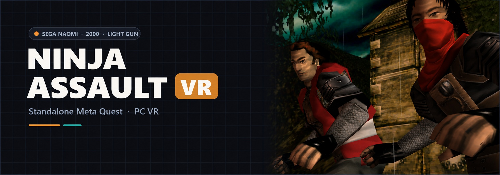

<div align="center">



# Ninja Assault VR
### SEGA NAOMI Light-Gun Action · Standalone Meta Quest & PC VR

[](https://github.com/vr4all-standalone/ninja-assault-vr/releases/latest)
[](#installation)
[](#what-you-need)

**[⬇️ Quest APK](https://github.com/vr4all-standalone/ninja-assault-vr/releases/latest/download/ninja-assault-vr-quest.apk)** · **[🖥️ PC VR ZIP](https://github.com/vr4all-standalone/ninja-assault-vr/releases/latest/download/ninja-assault-vr-pcvr.zip)** · **[🎮 Controls](#controls)**

**[🌐 VR4ALL — Standalone VR Mod Installer](https://github.com/vr4all-standalone/vr4all-standalone-vr-mod-installer)**

</div>

---

## Update v1.0.6

Validated automatic entry, full P1 red/P2 blue Arcade body and grip with grey details preserved, and a new gun-angle zero matching the old -10 degree pose. Legacy angles reset once; later adjustments persist. [Release notes](docs/releases/v1.0.6.md).

## Overview

**Ninja Assault VR** brings Namco's arcade light-gun game to standalone Meta Quest and
PC VR. Flycast runs the original NAOMI game; its scenes are reconstructed in stereo,
and your tracked controllers become the light guns.

It carries over the menus and controller features of
**[Confidential Mission VR](https://github.com/vr4all-standalone/confidential-mission-vr)** and
**[Lupin the Third VR](https://github.com/vr4all-standalone/lupin-the-third-vr)**, with Ninja
Assault's own measured camera, aiming calibration, reloads and accepted-round feedback.
These projects build on **[mikermak's VR fork of Flycast](https://github.com/mikermak/hotd2-vr)**,
itself based on **[Flycast](https://github.com/flyinghead/flycast)**.

> **No game included.** Supply your own complete **World NJA2 Ver.A** cartridge set and
> NAOMI BIOS. This is an unofficial fan project, not affiliated with Namco, Sega, Meta
> or the Flycast project. Releases contain no ROM, BIOS, game audio or extracted game model.

**Status: experimental.** Quest and Windows builds, simulator gameplay, aiming, menus,
reloads and hand transitions pass the recorded checks. **Physical headset testing and
later-stage coverage remain pending.** The original wood-and-metal **Mach Gun** is
automatically extracted from your own game on first launch. Arcade, Zapper and custom
GLB guns remain available.

## Key VR features

- **Stereo 3D and tracked viewing.** Move and turn your head inside reconstructed scenes.
  Wider view draws extra scenery while preserving the original game's hit-test lens.
  HUD, subtitles and instructions sit on an adjustable panel in front of you.
- **Your controller is the light gun.** Choose the original **In-game Mach Gun**,
  extracted from your own game, the Arcade gun, Zapper or your own GLB. Adjust gun angle from **−30° to +30°**, gun size and world size.
- **Feedback follows real rounds.** Recoil, muzzle flash and haptics follow the game's
  accepted shots. Empty magazines click without a firing kick. Haptics offers
  **Off, Light, Medium and Strong**.
- **Two players on one headset.** Each controller controls a separate player, with its
  own eight-round magazine and game state. **Two players defaults to P1 left / P2 right**.
  Reverse the assignment in settings while keeping each player's state.
- **Either hand in single player.** Pull either trigger to shoot and transfer P1's gun
  to that hand. The two-player hand preference does not change this behavior.
- **Two reload modes.** Shoot off-screen, or point off-screen once per exit. **B/Y**
  also reload. Native free play lets Start begin a game without a coin action.
- **Empty hands during story scenes.** Guns, controllers and lasers hide during
  noninteractive story sequences and return for combat.
- **A paused menu in the headset.** Adjust guns, angle, reloads, hands, laser, haptics,
  world size, panel distance and wider view. Settings save immediately. How to play
  shows labelled controllers, and Quit requires a second selection.
- **A setup screen that checks your files.** READY or a specific missing-file message
  appears before Play enables. Separate app identity, settings and saves let this
  coexist with the other ports.

<a id="installation"></a>
## Installation on Meta Quest

Quest 3 is the primary target. Quest 3S, Quest 2 and Quest Pro are inherited compatibility
targets; physical validation is pending for this Ninja Assault port.

<a id="what-you-need"></a>
### What you need

Use the complete **World NJA2 Ver.A** cartridge set, MAME/Flycast name **`ninjaslt`**.
Other regional sets (`ninjaslta`, `ninjasltj`, `ninjasltu`) are not supported by the initial
standalone setup. Renaming a regional archive does not make it the supported World set.

| File | Quest location | PC portable location |
| :--- | :--- | :--- |
| `ninjaslt.zip` | `Download/ninjaslt.zip` | `roms/ninjaslt.zip` |
| `naomi.zip` | `Download/naomi.zip` | `roms/naomi.zip` |

Keep both ZIPs packed and retain these lowercase filenames. A supported BIOS can instead
be embedded in the game ZIP. The cartridge ZIP must contain all **12 required ROM entries**
with matching uncompressed sizes and CRC metadata; an incomplete split set will not pass.
No CHD, disc track folder or PIC file is needed for this cartridge game.

The setup checks ZIP structure and entry metadata; it does not hash every payload byte
or certify full data integrity. Keep your original files and prepare a separate copy.

### Install and start

1. Enable developer mode and sideload **`ninja-assault-vr-quest.apk`** with your preferred tool.
2. Copy your own game and BIOS files to the layout above.
3. Open **Ninja Assault VR** under **Unknown sources**. If prompted, enable **All files access**.
4. Select **Look again**. When setup says **READY**, select **Play**.
5. On first launch, keep the app open while it watches the attract demo and makes
   your **Mach Gun**. **B** skips to the Arcade gun for this session; next launch retries.
6. Press **A** to start P1. Press **X** to join P2 when you want two guns.

The complete gun is cached for later launches. Missing, incomplete or corrupt caches
are regenerated. Preparation took about **17 seconds on the development PC**; Quest
timing is unmeasured. Choose **Menu → Gun → In-game Mach Gun** to return to it after
selecting another gun. Both players use this native model.

Quit from the VR menu returns to setup. Play then starts a fresh game process. The app's
own games folder also works without shared-storage access. Android package:
**`com.vrlightgunhub.ninjaassault`**.

## PC VR

Unpack **`ninja-assault-vr-pcvr.zip`** into its own folder and add your files:

```text
flycast.exe
emu.cfg
Play Ninja Assault.cmd
roms/
    ninjaslt.zip
    naomi.zip
```

Connect the headset to your active **OpenXR** runtime, such as SteamVR or Quest Link,
then run **`Play Ninja Assault.cmd`**. The portable configuration enables OpenGL,
native depth interpolation and VR. Keep this folder separate from other Flycast ports.

## Controls

| Quest Touch input | Single-player action |
| :--- | :--- |
| **A** | Start P1 |
| **X** | Start or join P2 |
| **B or Y** | Reload P1 |
| **Either trigger** | Shoot; move P1's gun to that hand |
| **Left Menu** | Open or close paused settings |
| **Left stick click** | Recenter |
| **Right stick click** | Toggle laser |
| **Grip + stick up/down** | Change world size |
| **Grip + stick left/right** | Change gun size |
| **Stick** | Game D-pad |

**With both players active**, **Two players → P1 left / P2 right** is the default.
Left **X/Y** become P1 Start/Reload; right **A/B** become P2 Start/Reload.
Choose **P1 right / P2 left** to reverse the two-player assignment. Single-player
Start/join buttons and either-trigger transfer keep the behavior shown above.
Touch, Index, Vive and WMR use their controller-specific labels and bindings.

Start ownership matches Confidential Mission: a held A or X stays with its original player until released through joining, leaving or reversing **Two players**. Simultaneous A/X presses keep P1 and P2 separate.

## Menu

**Resume · Recenter · Gun · Gun angle · Reload · Two players · Laser · Haptics ·
World size · Panel distance · Wider view · How to play · Quit**

Either pointer and stick navigation work in the menu. Simulation and audio pause while
head tracking stays live. Gun selection includes a preview. Quit needs confirmation.

## Custom guns and controllers

Place gun **GLB + matching JSON sidecar** files in `guns/`, or controller models in
`controllers/left.glb` and `controllers/right.glb` with matching sidecars.
On Quest these folders sit beside the game ZIP, for example `Download/guns/`.
On PC the app checks beside `flycast.exe`, then beside the game ZIP, then the bundled
`data/models/`. Matching user files override bundled models; controller sides fall
back independently. See the [model format](hotd2-vr/notes/ninja-development.md#user-models).

The **Mach Gun** is extracted locally from the heroes' story scene, with its original
wood and metal textures. It is a complete gun without the characters' hands. No extracted
model or game texture is included in the release files.

## Validation and development

The **v1.0.1** release tag identifies the binary source. Both executables embed that
commit. The 401 original focused checks and 31 Android setup checks are supplemented
by 14 renderer-cache checks and 16 shared gun-builder/cache cases. Simulator checks
cover automatic extraction, cached loading, skip/retry and the native model alongside
the existing aiming, two-player, reload, empty-click and menu behavior.

These checks do not establish physical tracking quality, stereo comfort, sustained
headset performance or every later stage. Please report the headset, game revision,
release version and reproduction steps when filing an issue.

- [Measured Ninja findings](hotd2-vr/notes/ninja-findings.md)
- [Validation record](hotd2-vr/notes/ninja-validation.md)
- [Physical headset checklist](hotd2-vr/notes/ninja-vr-headset-checklist.md)
- [Build and development notes](hotd2-vr/notes/ninja-development.md)
- [Upstream Flycast documentation](README.flycast.md)

## Credits and licence

- **Flycast** by flyinghead and contributors supplies the emulator.
- **mikermak's hotd2-vr** supplies the original VR rendering and tools.
- **Confidential Mission VR and Lupin the Third VR** supply the standalone setup,
  menu, controls and model infrastructure adapted for Ninja Assault.
- Bundled gun and controller authors, licences and modifications are listed in each
  release's **CREDITS.txt**. Preserve those notices when redistributing.
- The banner follows this project series' layout and uses Ninja Assault character
  imagery as reference. Underlying game artwork belongs to its respective owners.

Software releases are distributed under **GNU GPL version 3**; see
[LICENSE-RELEASE.txt](LICENSE-RELEASE.txt). Corresponding source is available in this
repository at the release tag. No commercial game data or private signing material
is included in the downloads.

### Player assignment regression

Run `powershell -NoProfile -File hotd2-vr/player-assignment-test.ps1` on a Windows development machine with Visual Studio C++ tools. It compiles the production hand policy, Start ownership, join/leave and menu code and checks both layouts against Confidential Mission behavior.

## Quest Start and Service buttons

Play launches immersive VR from passthrough or a virtual Quest Home. After loading,
**A** starts P1; **X** requests P2 where supported, after P1 has started. The second
gun appears only after native P2 acceptance. Two-player Starts follow the saved hand
assignment. Survivor retains its native single-player controls.

To enter Service, open the in-game VR menu and choose **Open Service Menu**, directly
above **Quit**. Holding A does not open Service. Normal controller buttons do not
enter the arcade menu; the row is available after initial loading, offline with VR guns enabled.

Inside standard NAOMI Service, **X = Next** and **tap A = Select**. The purple guide appears below
the native menu. Choose the native **EXIT** option to restart the game and restore
normal controls automatically; there is no B step. Leaving a submenu keeps Service
navigation available. Aiming, triggers and directions remain usable for native tests.

Held A/X inputs require release after opening, settings or focus recovery. Native
main-game boot and new game/session resets clear Service controls. Existing external
keyboard/gamepad cabinet controls remain available.

Ninja Assault and Survivor use Namco's native operator menu: **X = Down**,
**A = Enter**, with the stick also available for Up/Down. While it is open,
the same VR menu row reads **Exit Service Menu** and sends the native return
command after resuming. The guide and ordinary gameplay controls restore
automatically after the game leaves its operator menu. A alone never opens or
closes Service during ordinary gameplay.
